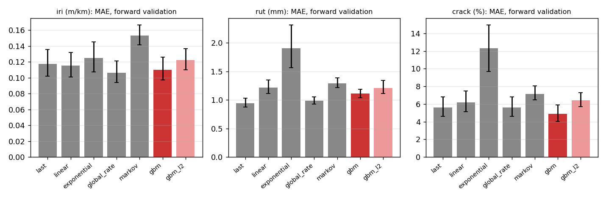
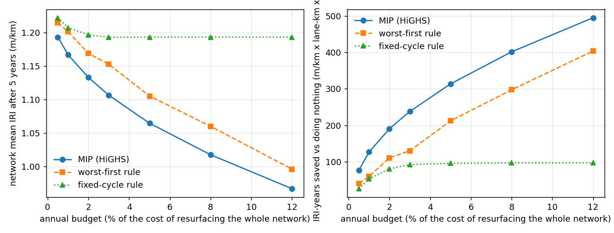

Personal desk study on public data; not a real maintenance plan or engineering advice.

# pavement-maintenance-ai

Pavement deterioration forecasting and budget-constrained maintenance planning on the public FHWA LTPP
database, with the Chinese highway condition indices (JTG 5210-2018) as a second view.
This file is generated from `results/*.json` by `scripts/make_report.py`; every number in it is read from
those files and a test checks that.

**What it found, in short**

- **IRI (m/km)**: gradient boosting (MAE 0.110) is not distinguishable from the best naive baseline, last value + network median rate (MAE 0.106); difference +0.004, interval -0.001 to +0.009.
- **rut depth (mm)**: gradient boosting (MAE 1.11) is worse than the best naive baseline, last value (MAE 0.94); difference +0.16, interval +0.09 to +0.24.
- **cracking (%)**: gradient boosting (MAE 4.88) beats the best naive baseline, last value (MAE 5.63); difference -0.75, interval -1.03 to -0.45.
- Splitting the same IRI pairs at random instead of by site puts boosting's MAE
  -23.6 % from the best baseline's (negative means
  lower error); with sites kept apart and the test period after the training period the figure is
  +3.6 %. The first number is a leak, not skill.
- Recorded treatments: a thin overlay lowered IRI by
  0.45 m/km on average, a thick one by
  1.01 m/km, a seal coat by
  -0.03 m/km (no measurable change in roughness).
- Network plan over 5 years on 491 sections at an
  annual budget of 3 % of the cost of resurfacing everything: the MIP
  saves 237.8 IRI-years against doing nothing, the worst-first rule
  129.9 with the same money
  (1.83 times as much).

## 中文摘要

个人利用公开数据做的案头研究，不是实际养护方案，也不构成工程建议。

- 数据：美国联邦公路局 LTPP 长期路面性能数据库（SDR 40），沥青面层路段
  1,823 个；IRI 检测 19,949 次、车辙 18,143
  次、裂缝调查 13,127 次（1989–2025 年）。
  原始数据不入库，只保留获取脚本与文件哈希；仓库内为小体量派生表。
- 性能预测（按站点分组留出，并且训练期在前、测试期在后）：对比末次值、本路段线性/指数外推、
  路网中位速率、马尔可夫链与梯度提升。结论如实记录：
- IRI（m/km）：梯度提升 MAE 0.110，与之无法区分：最优朴素基线「末次值＋路网中位衰变速率」（MAE 0.106），差值 +0.004（区间 -0.001 至 +0.009）。
- 车辙深度（mm）：梯度提升 MAE 1.11，不如最优朴素基线「末次观测值」（MAE 0.94），差值 +0.16（区间 +0.09 至 +0.24）。
- 裂缝率（%）：梯度提升 MAE 4.88，优于最优朴素基线「末次观测值」（MAE 5.63），差值 -0.75（区间 -1.03 至 -0.45）。
- 养护效果（养护前后实测对比，存在选择偏差）：薄层罩面平均降低 IRI
  0.45 m/km，厚罩面
  1.01 m/km，封层类
  -0.03 m/km（对平整度基本无改善）。
- 养护决策：491 个路段、5 年、年度预算约束下的混合整数规划
  （HiGHS 求解，5,065 个二元变量）。同等预算下节省的「IRI·年」为
  237.8，「最差优先」规则为
  129.9，前者是后者的
  1.83 倍。
- 中国标准视角：按 JTG 5210-2018 式 7.4.7 把 IRI 换算为 RQI、按式
  7.4.8 把车辙换算为 RDI，并按表 4.0.2 分级；薄层罩面适用条件取自
  JTG/T 5142-01-2021 表 5.3.2。系数与条款均核对自交通运输部官网文本，
  出处见 `docs/sources.md`。
- 工程化：134 个离线测试；变异测试首轮 58/62，
  补测试后 61/62（余下 1 个为等价变异，原因见结果文件）。

## Data

FHWA LTPP InfoPave Standard Data Release 40 (September 2026), downloaded on 2026-11-15 from https://infopave.fhwa.dot.gov/Data/StandardDataRelease without login
(8 archives, hashes in `data/raw_manifest.json`). The raw files are not in the repository;
`scripts/fetch_ltpp.py` fetches them and `scripts/dump_tables.py` plus `scripts/build_extracts.py` rebuild the
small extracts in `data/derived/` that everything else runs on.

Kept: 1,823 asphalt-surfaced test sections at 422 sites.

| indicator | visits | sections | years | median |
|---|---|---|---|---|
| IRI (mean of both wheel paths, m/km) | 19,949 | 1,817 | 1989–2025 | 1.13 |
| rut depth (mm) | 18,143 | 1,814 | 1989–2025 | 5.0 |
| cracking (% of area, HPMS definition) | 13,127 | 1,806 | 1988–2025 | 1.0 |

Recorded construction events on these sections: 531 seal coats or surface treatments,
291 thin, 373 medium and
556 thick overlays, and 1,973 routine jobs (crack sealing,
patching) that do not renew the surface.

**Terms of use.** InfoPave links to FHWA's disclaimer, which states that information on the site "is considered
public information and may be distributed or copied"; the data.gov record of LTPP gives the licence as U.S.
Government Works. Details, quotations and retrieval dates are in `docs/sources.md`. Requested citation:
Long Term Pavement Performance InfoPave, Standard Data Release, SDR 40, https://infopave.fhwa.dot.gov/Data/StandardDataRelease. FHWA does not endorse this work.

## A. Deterioration forecasting

A *pair* is an origin visit and a later visit on the same surface (no renewal in between),
0.5 to 5 years apart. Each method
predicts the later value from what was known at the origin.

- Baselines: last value; the section's own linear and exponential trend; last value plus the network's median
  annual rate; a Markov chain on condition states with a one-year step.
- Machine learning: gradient boosting on the increment, with age, time since the last renewal and its type,
  layer thicknesses, truck traffic and ESAL up to the origin year, climate normals, the own trend so far and the
  latest values of the other two indicators. Two variants are reported: the squared-error one was run first,
  the absolute-error one was added because the methods are ranked by MAE and is the one the verdicts use.
  Hyper-parameters were fixed beforehand and not tuned on the test folds.
- Validation: 5 folds of whole sites (a site is a state plus project, so
  co-located sections never sit on both sides). In the stricter scheme the training pairs must also end before
  2000 and the test pairs start in or after it. Intervals are
  95 % percentile intervals from 1,000 bootstrap
  resamples of whole sites.

Site-grouped and forward in time (the headline):

| method | IRI (m/km): MAE | rut depth (mm): MAE | cracking (%): MAE |
| --- | --- | --- | --- |
| last value | 0.117 (0.102 to 0.136) | 0.94 (0.88 to 1.03) | 5.63 (4.62 to 6.80) |
| own linear trend | 0.115 (0.101 to 0.132) | 1.21 (1.11 to 1.35) | 6.21 (5.12 to 7.47) |
| own exponential trend | 0.125 (0.107 to 0.145) | 1.90 (1.56 to 2.31) | 12.32 (9.68 to 14.96) |
| last value + network median rate | 0.106 (0.094 to 0.121) | 0.98 (0.92 to 1.05) | 5.63 (4.62 to 6.80) |
| Markov chain on condition states | 0.153 (0.142 to 0.167) | 1.29 (1.22 to 1.38) | 7.16 (6.46 to 8.04) |
| gradient boosting (absolute-error loss) | 0.110 (0.097 to 0.126) | 1.11 (1.04 to 1.18) | 4.88 (4.02 to 5.88) |
| gradient boosting (squared-error loss) | 0.123 (0.110 to 0.137) | 1.21 (1.11 to 1.34) | 6.44 (5.70 to 7.29) |
| test pairs / sites | 17,916 / 299 | 20,027 / 296 | 9,954 / 277 |

Site-grouped only:

| method | IRI (m/km): MAE | rut depth (mm): MAE | cracking (%): MAE |
| --- | --- | --- | --- |
| last value | 0.150 (0.134 to 0.167) | 1.23 (1.12 to 1.38) | 5.51 (4.72 to 6.35) |
| own linear trend | 0.145 (0.130 to 0.160) | 1.61 (1.44 to 1.80) | 5.91 (5.05 to 6.81) |
| own exponential trend | 0.156 (0.139 to 0.174) | 2.32 (1.93 to 2.75) | 10.09 (8.42 to 11.91) |
| last value + network median rate | 0.134 (0.120 to 0.148) | 1.23 (1.12 to 1.38) | 5.43 (4.68 to 6.24) |
| Markov chain on condition states | 0.172 (0.158 to 0.185) | 1.39 (1.28 to 1.52) | 6.57 (6.06 to 7.17) |
| gradient boosting (absolute-error loss) | 0.127 (0.114 to 0.140) | 1.19 (1.09 to 1.33) | 4.93 (4.26 to 5.64) |
| gradient boosting (squared-error loss) | 0.135 (0.122 to 0.148) | 1.26 (1.15 to 1.39) | 6.28 (5.71 to 6.90) |
| test pairs / sites | 49,409 / 422 | 43,253 / 420 | 22,083 / 400 |

Boosting against the best baseline, by horizon:

| indicator | validation | horizon (years) | best baseline | its MAE | boosting MAE | boosting minus baseline (interval) | change | verdict |
| --- | --- | --- | --- | --- | --- | --- | --- | --- |
| IRI (m/km) | site-grouped + forward in time | 0.5 to 5 | last value + network median rate | 0.106 | 0.110 | +0.004 (-0.001 to +0.009) | +3.6 % | no detectable difference |
| IRI (m/km) | site-grouped + forward in time | 0.5 to 2 | last value + network median rate | 0.082 | 0.084 | +0.002 (+0.000 to +0.005) | +2.7 % | boosting is worse |
| IRI (m/km) | site-grouped + forward in time | 2.0 to 5 | last value + network median rate | 0.127 | 0.132 | +0.005 (-0.001 to +0.013) | +4.0 % | no detectable difference |
| IRI (m/km) | site-grouped | 0.5 to 5 | last value + network median rate | 0.134 | 0.127 | -0.007 (-0.010 to -0.003) | -5.0 % | boosting is better |
| IRI (m/km) | site-grouped | 0.5 to 2 | last value + network median rate | 0.093 | 0.092 | -0.001 (-0.003 to +0.001) | -0.8 % | no detectable difference |
| IRI (m/km) | site-grouped | 2.0 to 5 | last value + network median rate | 0.161 | 0.150 | -0.011 (-0.015 to -0.006) | -6.6 % | boosting is better |
| rut depth (mm) | site-grouped + forward in time | 0.5 to 5 | last value | 0.94 | 1.11 | +0.16 (+0.09 to +0.24) | +17.3 % | boosting is worse |
| rut depth (mm) | site-grouped + forward in time | 0.5 to 2 | last value | 0.85 | 1.06 | +0.22 (+0.17 to +0.27) | +25.6 % | boosting is worse |
| rut depth (mm) | site-grouped + forward in time | 2.0 to 5 | last value | 1.04 | 1.15 | +0.11 (+0.02 to +0.21) | +10.7 % | boosting is worse |
| rut depth (mm) | site-grouped | 0.5 to 5 | last value | 1.23 | 1.19 | -0.04 (-0.09 to +0.02) | -3.1 % | no detectable difference |
| rut depth (mm) | site-grouped | 0.5 to 2 | last value | 1.02 | 1.07 | +0.05 (+0.01 to +0.09) | +5.0 % | boosting is worse |
| rut depth (mm) | site-grouped | 2.0 to 5 | last value | 1.37 | 1.27 | -0.10 (-0.17 to -0.03) | -7.2 % | boosting is better |
| cracking (%) | site-grouped + forward in time | 0.5 to 5 | last value | 5.63 | 4.88 | -0.75 (-1.03 to -0.45) | -13.3 % | boosting is better |
| cracking (%) | site-grouped + forward in time | 0.5 to 2 | last value | 3.43 | 3.24 | -0.19 (-0.39 to +0.01) | -5.5 % | no detectable difference |
| cracking (%) | site-grouped + forward in time | 2.0 to 5 | last value | 7.26 | 6.10 | -1.16 (-1.54 to -0.75) | -16.0 % | boosting is better |
| cracking (%) | site-grouped | 0.5 to 5 | last value + network median rate | 5.43 | 4.93 | -0.50 (-0.72 to -0.31) | -9.2 % | boosting is better |
| cracking (%) | site-grouped | 0.5 to 2 | last value | 3.49 | 3.22 | -0.26 (-0.39 to -0.14) | -7.5 % | boosting is better |
| cracking (%) | site-grouped | 2.0 to 5 | last value + network median rate | 6.59 | 5.97 | -0.63 (-0.92 to -0.33) | -9.5 % | boosting is better |

What a leaky split would have shown for IRI:

| how the IRI pairs are split | best baseline MAE | boosting MAE | boosting vs baseline |
| --- | --- | --- | --- |
| at random, pair by pair (leaky: wrong) | 0.133 | 0.102 | -23.6 % |
| by site (no section on both sides) | 0.134 | 0.127 | -5.0 % |
| by site and forward in time | 0.106 | 0.110 | +3.6 % |



### Treatment effects from the work history

Last measurement on the old surface (at most 3 years before
the event) against the first one on the new surface (at most 2
years after). Rates are least-squares slopes over at least
3 visits.

IRI (m/km):

| treatment class | events / sites | median thickness (mm) | median before | median after | mean drop (interval) | rate before -> after (per year) | mean rate change (interval) |
| --- | --- | --- | --- | --- | --- | --- | --- |
| seal coat / surface treatment | 407 / 147 | n/a | 1.22 | 1.24 | -0.03 (-0.09 to +0.04) | 0.027 -> 0.027 | +0.015 (-0.012 to +0.041) |
| thin overlay (up to 40 mm) | 223 / 129 | 36 | 1.23 | 0.91 | +0.45 (+0.37 to +0.54) | 0.022 -> 0.022 | -0.008 (-0.020 to +0.006) |
| medium overlay (over 40, under 75 mm) | 290 / 117 | 51 | 1.27 | 0.81 | +0.61 (+0.47 to +0.76) | 0.026 -> 0.020 | -0.014 (-0.046 to +0.006) |
| thick overlay (75 mm or more) or reconstruction | 411 / 139 | 107 | 1.76 | 0.88 | +1.01 (+0.88 to +1.15) | 0.048 -> 0.025 | -0.049 (-0.067 to -0.030) |

Rut depth (mm):

| treatment class | events / sites | median thickness (mm) | median before | median after | mean drop (interval) | rate before -> after (per year) | mean rate change (interval) |
| --- | --- | --- | --- | --- | --- | --- | --- |
| seal coat / surface treatment | 333 / 120 | n/a | 6.0 | 5.0 | +0.5 (+0.1 to +1.1) | 0.15 -> 0.18 | +0.07 (-0.03 to +0.19) |
| thin overlay (up to 40 mm) | 196 / 110 | 38 | 6.0 | 2.0 | +4.4 (+3.6 to +5.2) | 0.29 -> 0.19 | -0.10 (-0.19 to +0.05) |
| medium overlay (over 40, under 75 mm) | 275 / 113 | 51 | 7.0 | 2.0 | +5.4 (+4.6 to +6.3) | 0.33 -> 0.18 | -0.30 (-0.66 to +0.13) |
| thick overlay (75 mm or more) or reconstruction | 260 / 112 | 107 | 7.0 | 2.0 | +4.7 (+3.8 to +5.7) | 0.05 -> 0.19 | +0.21 (+0.08 to +0.36) |

Cracking (%):

| treatment class | events / sites | median thickness (mm) | median before | median after | mean drop (interval) | rate before -> after (per year) | mean rate change (interval) |
| --- | --- | --- | --- | --- | --- | --- | --- |
| seal coat / surface treatment | 251 / 79 | n/a | 4.0 | 0.0 | +7.7 (+3.6 to +12.6) | 2.42 -> 1.05 | -1.56 (-2.87 to +0.14) |
| thin overlay (up to 40 mm) | 170 / 80 | 36 | 12.5 | 0.0 | +18.8 (+12.6 to +24.1) | 2.96 -> 3.09 | +0.22 (-1.45 to +1.47) |
| medium overlay (over 40, under 75 mm) | 239 / 88 | 51 | 7.0 | 0.0 | +14.3 (+11.1 to +17.3) | 0.93 -> 0.33 | +0.14 (-1.15 to +1.45) |
| thick overlay (75 mm or more) or reconstruction | 164 / 73 | 104 | 3.0 | 0.0 | +13.0 (+8.3 to +17.7) | 0.48 -> 1.40 | +0.39 (-0.58 to +1.28) |

These are before/after differences, not causal effects. Agencies choose which sections to treat and when; the
"before" value is taken near a peak, so part of the drop is regression to the mean; and thicker overlays went
onto rougher pavements (see the "median before" column), so the classes are not comparable groups.

## B. Network-level plan under an annual budget

The network is made of the 491 sections whose last profile visit is in
2010 or later and that have a rut and a cracking survey on the
current surface (8 of
499 candidates lack one). Each stands for one lane-km. Mean IRI at the start is
1.12 m/km.

Do-nothing growth: 0.023 m/km per year for every section, because
boosting did not beat the best baseline under forward validation, so the baseline's network-wide rate is used.

| treatment level | LTPP effect class | IRI after treatment (m/km) | IRI growth after (m/km per year) | cost (thousand USD per lane-km) | allowed when |
| --- | --- | --- | --- | --- | --- |
| preventive (thin overlay) | thin overlay (up to 40 mm) | 0.698 + 0.181 x IRI before | 0.025 | 86.7 | PCI and RQI at least 85, RDI at least 80 |
| minor rehabilitation (resurfacing) | medium overlay (over 40, under 75 mm) | 0.646 + 0.146 x IRI before | 0.020 | 206.3 | PCI at least 70 |
| major rehabilitation (thick overlay / reconstruction) | thick overlay (75 mm or more) or reconstruction | 0.748 + 0.084 x IRI before | 0.025 | 720.8 | always |

The MIP has one binary variable per allowed (section, year, treatment), at most one treatment per section in
the horizon and one budget row per year; the objective is the IRI-years saved against doing nothing. It is
solved with HiGHS (5,065 binaries,
496 rows, status Optimal, stopped once the plan was
proven within 1.0 % of the best bound; the base case ended
0.58 % from it).
The worst-first rule ranks sections by current IRI and resurfaces those at or above
1.5 m/km (thick overlay at or above
2.5 m/km or where resurfacing is not allowed) until the year's money
is gone. The fixed-cycle rule gives a thin overlay to every surface that is
8 years old, oldest first.

Annual budget 3.04 million USD
(3 % of the 101.3
million it would cost to resurface the whole network):

| strategy | IRI-years saved | mean IRI after the plan (m/km) | share of length at or below the trigger | sections treated (preventive / minor / major) | spend (million USD) |
| --- | --- | --- | --- | --- | --- |
| do nothing | 0.0 | 1.240 | 77.2 % | 0 (0 / 0 / 0) | 0.00 |
| MIP (HiGHS) | 237.8 | 1.106 | 86.2 % | 85 (60 / 16 / 9) | 14.99 |
| worst-first rule | 129.9 | 1.152 | 81.9 % | 23 (0 / 4 / 19) | 14.52 |
| fixed-cycle rule | 91.9 | 1.193 | 80.0 % | 136 (136 / 0 / 0) | 11.79 |

Budget sensitivity:

| annual budget (% of resurfacing everything) | MIP: IRI-years saved | worst-first | fixed-cycle | MIP / worst-first | MIP: mean IRI after (m/km) | worst-first: mean IRI after |
| --- | --- | --- | --- | --- | --- | --- |
| 0.5 | 76.1 | 39.7 | 25.5 | 1.92 | 1.193 | 1.215 |
| 1.0 | 126.2 | 59.5 | 52.8 | 2.12 | 1.167 | 1.201 |
| 2.0 | 190.3 | 110.1 | 80.1 | 1.73 | 1.133 | 1.169 |
| 3.0 | 237.8 | 129.9 | 91.9 | 1.83 | 1.106 | 1.152 |
| 5.0 | 313.7 | 212.1 | 95.3 | 1.48 | 1.064 | 1.105 |
| 8.0 | 401.8 | 297.5 | 96.5 | 1.35 | 1.017 | 1.060 |
| 12.0 | 495.4 | 404.1 | 96.5 | 1.23 | 0.966 | 0.996 |



To save as many IRI-years as the MIP does at the base budget, the worst-first rule needs about
2.0 times the money (interpolated on the table
above).

Other checks: with the thin overlay priced at the low and at the high end of the published range the MIP saves
2.30 and
1.57 times as many IRI-years as worst-first. With
section-specific growth rates from the boosting model instead of the single network rate, the ratio is
1.89 and
88.6 % of the sections treated under either rate model are
treated under both.

## C. Chinese standard view

JTG 5210-2018 (EN) Highway Performance Assessment Standard, official English edition (Ministry of Transport of the People's Republic of China; https://xxgk.mot.gov.cn/jigou/glj/202204/P020220425579066545831.pdf,
retrieved 2026-11-17):

- Clause 7.4.7: RQI = 100 / (1 + a0 · exp(a1 · IRI)), with a0 =
  0.026 and a1 = 0.65
  for motorways and class-one highways (a0 = 0.0185, a1 =
  0.58 for the other classes).
- Clause 7.4.8: RDI = 100 − a0 · RD up to RDa, then 90 − a1 · (RD − RDa) up to RDb, 0 above, with a0 = 1.0, a1 =
  3.0, RDa = 10 mm and RDb =
  40 mm (RD is the rut depth).
- Clause 7.4.5: PCI = 100 − a0 · DR^a1, with a0 = 15.00 and a1 =
  0.412 for asphalt, DR being the distress ratio in %.
- Table 4.0.2: excellent from 90, good from
  80, average from 70, poor from
  60, failed below.

On an expressway the grade limits therefore sit at IRI 2.23,
3.48, 4.31 and
4.99 m/km. 92.5 % of all
19,949 LTPP profile visits used here would be graded excellent on riding quality: by this
scale RQI hardly moves over the range in which most of these sections live, so the planning model works on IRI
itself and reports the grades alongside.

Grades of the planning network at the start (share of sections):

| index | excellent (优) | good (良) | average (中) | poor (次) | failed (差) |
| --- | --- | --- | --- | --- | --- |
| RQI from IRI | 94.9 % | 4.5 % | 0.6 % | 0.0 % | 0.0 % |
| RDI from rut depth | 94.5 % | 3.7 % | 1.2 % | 0.4 % | 0.2 % |
| PCI from cracking percent (approximation) | 42.4 % | 9.0 % | 6.3 % | 5.5 % | 36.9 % |

JTG/T 5142-01-2021, Table 5.3.2, suits a thin
overlay on an expressway to pavements with PCI and RQI of at least
85 and RDI of at least
80; that window is the eligibility rule for the
preventive treatment in part B (RQI 85 is IRI
2.95 m/km, RDI 80 is a
rut of 13.3 mm, PCI 85 is a
distress ratio of 1.0 %).
49.1 % of the network's sections pass it.

## D. Maintenance brief

`docs/brief.md` is a short Chinese-and-English brief generated from the same results by the same script; its
numbers are checked by the same test.

## Inputs: real, calibrated or assumption

| input | kind | basis |
| --- | --- | --- |
| IRI, rut depth, cracking, layer thickness, truck traffic, ESAL, climate, work history | real | LTPP SDR 40 (FHWA InfoPave), release level E records |
| RQI and RDI formulas, coefficients, grade limits | real | JTG 5210-2018, clauses 7.4.7, 7.4.8, Table 4.0.2 |
| PCI formula and coefficients for asphalt pavement | real | JTG 5210-2018, clause 7.4.5 |
| Thin overlay allowed only while PCI and RQI are 85 or more and RDI is 80 or more | real | JTG/T 5142-01-2021, Table 5.3.2 (expressway) |
| LTPP cracking percent (HPMS definition) used as the distress ratio DR in the PCI formula | assumption | none; DR in JTG 5210-2018 weights each distress type and severity, which is not reproduced |
| Resurfacing allowed only while PCI is 70 or more | assumption | none; 70 is the lower limit of grade 'average' |
| Thin overlay = 40 mm or less | real | JTG/T 5142-01-2021, commentary to clause 2.1.1 |
| Unit costs of resurfacing and reconstruction | real | FHWA C&P report, 24th ed., Exhibit A-5 (2016 USD) |
| Unit cost of a thin overlay | assumption | midpoint of the range in FHWA-HIF-10-020 (2009 USD), not inflated |
| IRI after a treatment as a line in the IRI before; IRI growth rate after a treatment | calibrated | before/after pairs of LTPP events, results/treatment_effects.json |
| Do-nothing IRI growth rate | calibrated | method that wins the forward validation, results/deterioration.json |
| 75 mm limit between medium and thick overlay | assumption | none |
| One lane-km per test section; network = sections profiled since 2010 | assumption | none |
| At most one treatment per section in the five-year plan | assumption | keeps the model linear |
| Budget levels; worst-first triggers 1.5 and 2.5 m/km; 8-year cycle; 0.5 m/km floor | assumption | none |
| Pricing a thick overlay as a reconstruction | assumption | none; on the high side |
| Markov state limits; five-year maximum horizon; year-2000 time cut | assumption | none |

## Limitations

- LTPP test sections are short research sections scattered over North America, not one operator's network, and
  not Chinese expressways (different structures, axle loads, climate and maintenance practice). The "network"
  in part B is a stand-in built from real section states.
- The forecasting comparison says what these methods do on LTPP visits a few years apart. It does not say that
  machine learning cannot help on denser, more uniform network surveys.
- The plan optimises roughness only. Cracking and rutting enter as eligibility at the start of the plan and are
  not projected forward; structural capacity, safety, user cost and traffic disruption are absent. With
  roughness as the only goal and a short horizon, thicker treatments buy little that thin ones do not, which
  the measured after-treatment IRI already shows; a real programme has other reasons for them.
- One treatment per section in the horizon, a linear do-nothing path and deterministic effects.
- Treatment effects are before/after differences with selection bias (see above).
- Unit costs are U.S. figures from two FHWA documents in different dollar years; the thin-overlay cost is the
  midpoint of a wide range. The PCI used for eligibility is an approximation (LTPP cracking percent in place
  of the standard's weighted distress ratio).
- Items that could not be verified are listed in `docs/sources.md`.

## Reproduce

Python 3.11, pinned in `requirements.txt`.

```
python -m venv .venv
.venv/Scripts/python -m pip install -r requirements.txt     # Linux/macOS: .venv/bin/python
.venv/Scripts/python -m pytest                              # offline
.venv/Scripts/python scripts/run_all.py                     # recompute results/*.json and figures
.venv/Scripts/python scripts/make_report.py                 # rebuild README.md and docs/brief.md
```

Rebuilding the extracts from the source needs `requirements-data.txt` and network access:
`scripts/fetch_ltpp.py`, then `scripts/dump_tables.py`, then `scripts/build_extracts.py`.

## Tests

134 offline tests (`pytest`), most of them hand-calculated cases; the workflow in
`.github/workflows/ci.yml` runs them with the pinned requirements and regenerates this file to compare.
Mutation testing (`mutation/run_mutants.py`): a control mutant that must be caught runs first; then
62 deliberate bugs were injected one at a time. First run: 58
caught, 4 survived. After adding tests for the survivors:
61 of 62 caught; 1 left, which
`results/mutation.json` lists with the reason (a mutant that changes no output cannot be caught). Both runs are
in that file.

## Licence

Code and text: MIT (see `LICENSE`). The LTPP data and the cited standards and reports belong to their issuers
and are used under the terms recorded in `docs/sources.md`.
